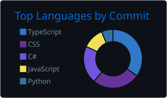
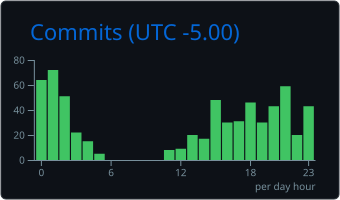

  <h1>Iván Mejía (Nuz777)</h1>
  

    I consider myself a responsible, kind, and calm person. I really enjoy programming; I like seeing that what I can do can be useful to many people, and I very rarely give up.
  

## About Me

Ever since I was a child, I've been fascinated by the world of rally racing, where precision, control, and speed define everything.
That same mindset guides my approach to programming: fast, efficient, and always striving for improvement despite my mistakes.
I'm motivated by challenges that demand mental sharpness and flawless execution, whether behind the wheel or in front of my laptop.

---

###  Tech Stack & Tools

#### **Backend & Databases**

  

#### **Frontend**

  

#### **DevOps, Tools & Environments**

  

---

---

##  GitHub Analytics

  

  
  

 

---

## Connect

  
  
  
  

  <i>"Nothing is impossible if you see that you're not truly tired yet."</i>

  

