 

 

 

## 👋 Hi, I'm Iván

I consider myself a **responsible, kind, and calm** person. I really enjoy programming; I like seeing that what I can do can be useful to many people, and I very rarely give up.

 

## 🏁 About Me

Ever since I was a child, I've been fascinated by the world of **rally racing**, where precision, control, and speed define everything. That same mindset guides my approach to programming: fast, efficient, and always striving for improvement despite my mistakes.

I'm motivated by challenges that demand mental sharpness and flawless execution, whether behind the wheel or in front of my laptop.

 

## 🧰 Tech Stack

**Backend**

**Frontend**

**DevOps & Databases**

 

## 📊 GitHub Stats

 

 

## 📫 Connect

 

*"Nothing is impossible if you see that you're not truly tired yet."*

